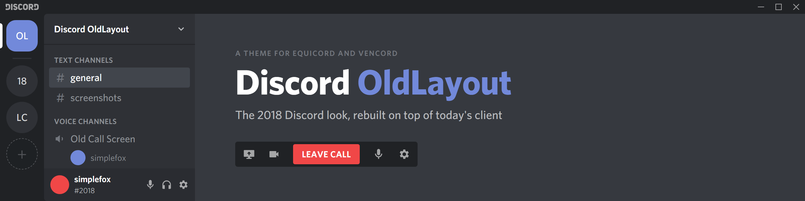
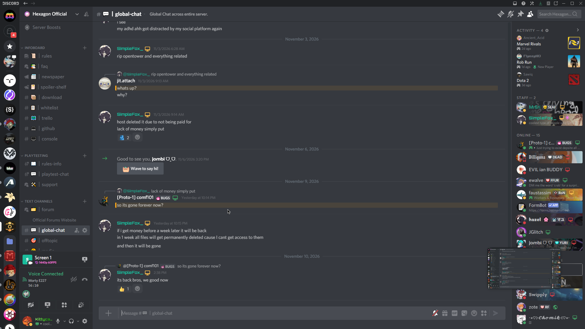
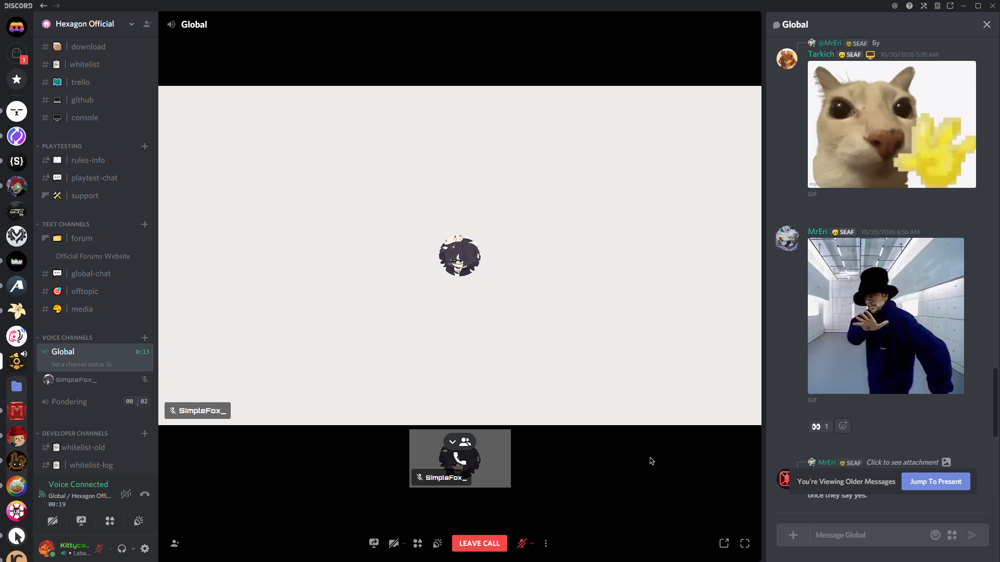
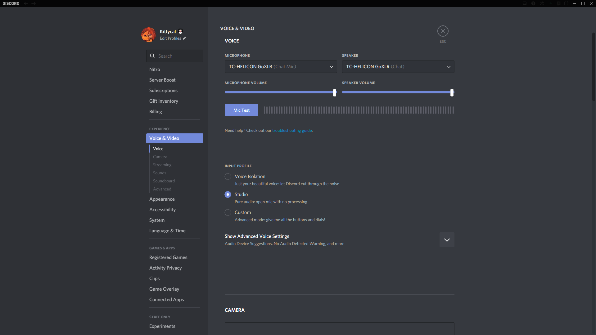
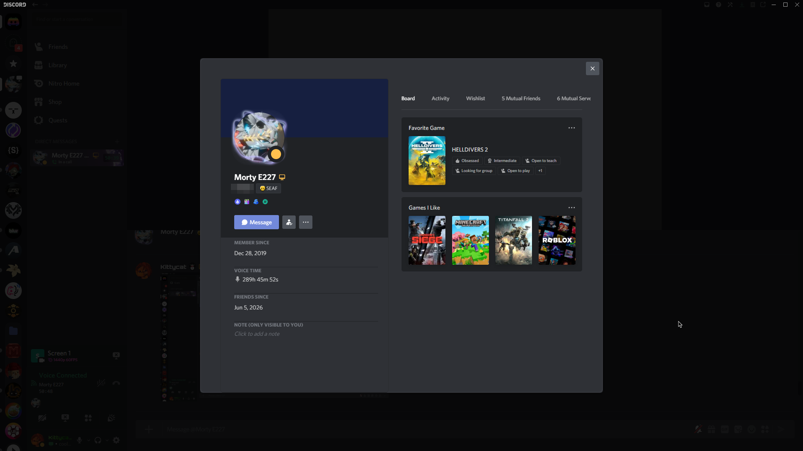
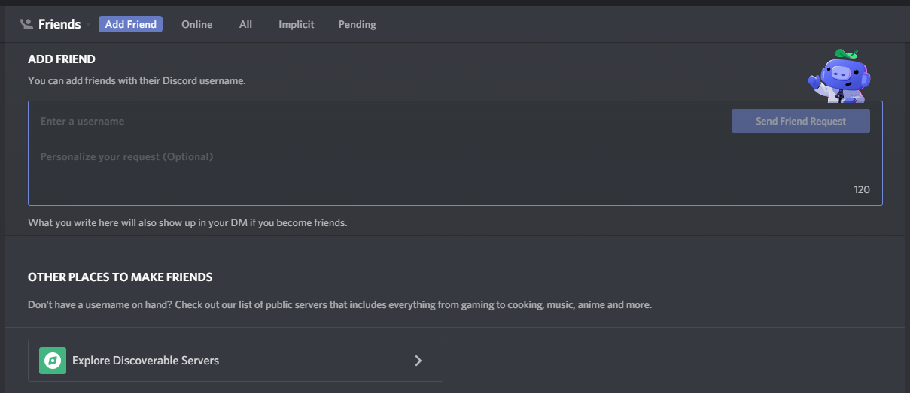

<p align="center">
  
</p>

<p align="center">
  
  
  
  
  
</p>

This theme is made for Equicord and Vencord clients, and its goal is to bring back the old era of the Discord interface, right before the call interface got swapped for a Skype-inspired one.

Discord OldLayout recreates the layout and interface Discord had in its 2018-2019 versions as accurately as physically possible, worked out by digging into actual older Discord builds. But with a twist: it keeps that same design language for everything Discord added after 2019 and restyles those newer features to match. That way the whole of Discord looks faithful and coherent, one single design language that is supposed to bring back the golden times of our beloved platform (well, at those times).

## Screenshots

<p align="center">
  
  <br><sub>Server chat, member list and the account panel back under the channel list</sub>
</p>

<p align="center">
  
  <br><sub>Voice channel with the old call bar and its red LEAVE CALL button</sub>
</p>

<table>
  <tr>
    <td width="50%" align="center"><br><sub>Full-screen settings with the round ESC button</sub></td>
    <td width="50%" align="center"><br><sub>Newer profile features in the old style</sub></td>
  </tr>
</table>

<p align="center">
  
  <br><sub>Friends page with the 2018 tab bar</sub>
</p>

## What it does

- 2018 dark palette, the Whitney font and the 2018 icons
- The old Windows title bar, round server icons, and the account panel back under the channel list
- 2018 message layout, embeds, popouts, context menus and tooltips
- Full-screen settings with the round ESC button
- The old call bar with the red LEAVE CALL and green JOIN CALL buttons
- Newer things like activity cards, profile widgets, quests and the soundboard restyled to fit instead of removed
- Nitro color themes show through the 2018 layout, and the light theme keeps the dark server and channel columns of the older light clients

## Install

1. Download [`DiscordOldLayout.theme.css`](DiscordOldLayout.theme.css).
2. In Discord open Settings > Equicord (or Vencord) > Themes > Open Themes Folder and drop the file in.
3. Tick **Discord OldLayout** in the themes list.

Discord stopped hosting the regular and bold weights of Whitney, so those two fall back to Arial unless you add them yourself as a separate theme. The other weights load straight from Discord.

## Building

The source in `src/` is written with partial class names like `[class*="name_"]`, since Discord renames its classes every so often. `build.js` turns those into the exact class names of one Discord build, which is a lot faster for the browser to work with. When an update breaks parts of the theme:

```bash
node fetch-classes.js
node build.js
```

`fetch-classes.js` downloads the class list of the current Discord build into `classes.txt`, and `build.js` writes `DiscordOldLayout.theme.css`. Needs Node 18 or newer.

| File in `src/` | What it styles |
| --- | --- |
| `00-tokens.css` | 2018 colors, fonts and Discord's own variables |
| `10-layout.css` | Window title bar and the overall layout |
| `20-guilds.css` | Server list |
| `30-channels.css`, `31-dms.css`, `35-panels.css` | Channel list, DM list, account and voice panels |
| `40-header.css` | Chat header and its popouts |
| `50-messages.css`, `51-content.css` | Messages, markdown, embeds and attachments |
| `55-composer.css` | Chat input |
| `60-members.css`, `65-profiles.css` | Member list and profiles |
| `70-menus.css`, `75-modals.css`, `95-misc.css` | Menus, tooltips, modals, settings and the rest |
| `80-home.css` | Friends page |
| `85-pickers.css` | Emoji, GIF and sticker pickers |
| `90-voice.css` | Call screen |
| `96-themes.css` | Nitro color themes and light theme touches |
| `98-icons.css` | 2018 icon swaps |

## Issues

Found something broken or not styled yet? Open an [issue](../../issues). There are templates for bugs, parts that aren't styled yet, and things that broke after a Discord update.

---

<sub>Not affiliated with Discord. Discord, its logo and the Whitney typeface belong to their respective owners.</sub>
